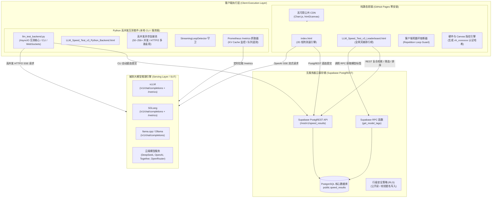

# 🚀 本地大模型推理速度测试与天梯榜平台 v3.5 (LLM Speed Test & Leaderboard)

[](https://github.com/gengchaogit/llm_speedtest)
[](LICENSE)
[](https://gengchaogit.github.io/llm_speedtest/)
[](https://www.python.org/)
[](https://supabase.com)
[](https://github.com/gengchaogit/llm_speedtest/pulls)

---

🇨🇳 [**简体中文 (当前)**](#) | 🇬🇧 [**English Documentation (README_en.md)**](README_en.md)

---

✨ **在线体验免安装纯前端版（零下载 / 零配置 / 点开即测）：**
- ⚡ **矩阵测速引擎 (Matrix Benchmark)**: [**https://gengchaogit.github.io/llm_speedtest/**](https://gengchaogit.github.io/llm_speedtest/)
- 🏆 **全网天梯榜 (Global Leaderboard)**: [**https://gengchaogit.github.io/llm_speedtest/LLM_Speed_Test_v3_Leaderboard.html**](https://gengchaogit.github.io/llm_speedtest/LLM_Speed_Test_v3_Leaderboard.html)

---

## 1. 项目简介 (Overview)

**本地大模型推理速度测试与天梯榜平台** 是一套面向开源大模型生态的工业级推理性能基准与天梯天梯排行榜系统。系统全面汲取了学术界与工业界顶级测试工具（如 `llm-inference-bench`、`vLLM benchmark_serving` 与 `AIPerf`）的核心精髓，建立起包括 **首字延迟 (TTFT)**、**Token 间延迟抖动 (ITL P50/P90/P99)**、**真实物理墙上时间吞吐 (Wall-clock TPS)**、**稳态持续解码 (Sustained Decode)**、**并发饱和度探测 `(X/Y)*`** 以及 **输出死循环熔断保护 (Repetition Watchdog)** 在内的严谨基准评测规范。

平台提供两种互补的运行形态：
1. **纯前端免部署架构 (Web Client)**：100% 运行于浏览器沙箱内，无任何自建中间件依赖，通过高可用公共 CDN 载入可视化组件，直接通过 PostgREST 协议安全对接 Supabase 云端数据库，零成本托管于 GitHub Pages。
2. **高并发 Python 压测套件 (Python Suite)**：基于 AsyncIO 与 HTTP/2 连接池构建，突破浏览器 6 并发限制，支持 50～256+ 真实极限并发压测，内置 Prometheus `/metrics` 服务端状态遥测与一键跨平台启动脚本。

---

## 2. 核心架构与设计哲学 (Architecture & Design Philosophy)

### 2.1 高保真系统架构图 (ASCII)

```text
+---------------------------------------------------------------------------------------------------+
|                                  CLIENT EXECUTION LAYER (客户端层)                                |
|                                                                                                   |
|  [ 纯前端静态客户端 (GitHub Pages) ]                [ 高并发 Python 压测套件 (CLI / 服务端) ]     |
|  * index.html (2D 矩阵测速引擎)                     * llm_test_backend.py (AsyncIO / CLI / WebAPI) |
|  * LLM_Speed_Test_v3_Leaderboard.html (天梯榜)      * LLM_Speed_Test_v3_Python_Backend.html        |
|  * 100% 公共 CDN 载入 (Chart.js 4.4.1 / html2canvas)* 50~256+ HTTP/2 多路复用连接池 (h2 / httpx)   |
|  * 双通道 Repetition Watchdog 死循环熔断器           * Prometheus /metrics 遥测抓取器 (KV Cache)    |
|  * 客户端硬件 & Canvas 指纹引擎 (vh_xxxxxxxx)       * 真实墙上时间计算与 (X/Y)* 有效并发率判定     |
+---------------------------------------------------------------------------------------------------+
             |                                                  |
             | (OpenAI SSE Stream / Ollama API)                 | (高并发 HTTP/2 SSE 流式请求)
             v                                                  v
+---------------------------------------------------------------------------------------------------+
|                                    SERVING LAYER (被测推理引擎 SUT)                               |
|                                                                                                   |
|  * vLLM  (/v1/chat/completions + /metrics)          * SGLang (/v1/chat/completions + /metrics)    |
|  * llama.cpp server (/v1/chat/completions)         * Ollama (/api/chat & /v1/chat/completions)    |
|  * 商业 API: OpenAI / DeepSeek / Together / OpenRouter / 兼容 OpenAI 标准的第三方推理服务         |
+---------------------------------------------------------------------------------------------------+
             |                                                  |
             | 浏览器直接 REST POST (测试载荷 + 签名)            | CLI 直接 REST POST (自动化云端上榜)
             v                                                  v
+---------------------------------------------------------------------------------------------------+
|                              SERVERLESS CLOUD BACKEND (Supabase 云端服务)                         |
|                                                                                                   |
|  * PostgREST API 接口: https://cvezaerrczywfzqcaqmx.supabase.co/rest/v1/speed_results             |
|  * PostgreSQL 关系型数据库 (public.speed_results 核心表, GIN/B-Tree 组合索引)                     |
|  * RPC 存储过程: get_model_tags() 动态聚合热门模型标签                                             |
|  * 行级安全策略 (RLS): 匿名只读 + 匿名带约束安全写入，无需自建任何后端中转服务器                  |
+---------------------------------------------------------------------------------------------------+
```

### 2.2 模块数据流图 (Mermaid)



---

## 3. 特性对比矩阵 (Feature Comparison Matrix)

下表从 12 个关键工程与基准维度，将本平台与业内主流测试工具进行了横向对比：

| 评估维度 (#) | 本平台 (LLM Speed Test v3.5) | Ollama bench (原生) | vLLM benchmark_serving | llm-inference-bench (lil-bench) |
|---|---|---|---|---|
| **1. 架构部署形态** | **双模**：纯静态 GitHub Pages 免安装 + Python CLI | 本地 CLI 命令 | Python CLI 脚本 | Python CLI + Rich TUI |
| **2. 零安装 Web 体验** | **✅ 支持**：点开网页即测，无任何前置依赖 | ❌ 不支持 | ❌ 不支持 | ❌ 不支持 |
| **3. 并发测试范围** | **1 ～ 256+** (前端 1-6，Python 1-256+) | 仅单请求并发 (c=1) | 高并发 (由请求速率驱动) | 高并发矩阵配置 |
| **4. 2D 压测参数矩阵** | **✅ 完整支持** (并发阶梯 $\times$ 上下文阶梯二维扫描) | ❌ 仅单点测试 | ❌ 仅单批次测试 | ✅ 支持并发 $\times$ 上下文扫描 |
| **5. 持续与突发基准模式** | **✅ 完整支持** (Sustained Decode 与 Burst 模式) | ❌ 不支持 | ❌ 仅请求排队突发 | ✅ 规范支持持续稳态与突发 |
| **6. 毫秒级延迟分位数** | **✅ 完整采集** (TTFT 及 ITL P50/P90/P99) | 仅平均值与总时长 | 仅整体时延统计 | ✅ 采集各分位数与抖动标准差 |
| **7. 物理真实墙上吞吐** | **✅ 真实墙上时间**跨度计算，杜绝单请求累加求和虚标 | 仅提供单请求单次数据 | 统计吞吐 (req/s, tok/s) | ✅ 严谨真实跨度时间算法 |
| **8. 死循环熔断器 (Watchdog)** | **✅ 双通道支持**：周期模式熔断保护（Reasoning 与 Content 通道隔离） | ❌ 无保护 (模型死机耗尽 token) | ❌ 无保护 | ✅ 字符滑动窗口循环周期检测 |
| **9. 服务端队列遥测** | **✅ 支持** Prometheus 抓取与有效并发率 `(X/Y)*` 标记 | ❌ 无 | ❌ 无动态端到端队列抓取 | ✅ Prometheus 遥测及有效并发标记 |
| **10. 多引擎/模型兼容性** | **✅ 全兼容** (vLLM, SGLang, llama.cpp, Ollama, OpenAI) | 仅适配 Ollama 本地模型 | 深度绑定 vLLM 服务端 | 适配 vLLM, SGLang, Ollama |
| **11. 公开天梯榜与社会化分享** | **✅ 全网天梯榜** (帕累托散点、雷达图、指纹认证、深链分享) | ❌ 无榜单平台 | ❌ 无榜单平台 | ❌ 无公开云端榜单系统 |
| **12. 双语国际化支持** | **✅ 100% 静态中英双语**热切换，无外部翻译 API 依赖 | 仅英文 | 仅英文 | 仅英文 |

---

## 4. 评测方法论与数学公理 (Benchmarking Methodology & Mathematical Rigor)

性能测试的公信力源于数学严谨性与物理真实性。本平台严格遵循以下公式和判定准则：

### 4.1 首 Token 延迟 (TTFT - Time To First Token)

**定义**：从客户端发出 HTTP 请求网络封包的瞬间，到接收到服务端流式返回的第一个有效 Token（含思考推理标签）之间经历的真实物理时间。

对于测试单元内的第 $i$ 个并发请求（$i \in [1, C]$）：
$$\text{TTFT}_i = t_{\text{first}, i} - t_{\text{start}, i}$$

单元平均首 Token 延迟与分位数计算：
$$\text{TTFT}_{\text{avg}} = \frac{1}{C} \sum_{i=1}^C \text{TTFT}_i$$
分位数通过**连续线性插值法**计算：对于升序排列样本序列 $Y = [y_1, y_2, \dots, y_N]$，其 $p$ 分位数对应秩索引：
$$k = (N - 1) \times \frac{p}{100}, \quad f = \lfloor k \rfloor, \quad \Delta = k - f$$
$$\text{Quantile}(Y, p) = y_f + \Delta \times (y_{f+1} - y_f)$$
由此严谨推导出 $\text{TTFT}_{P50}$、$\text{TTFT}_{P90}$ 与 $\text{TTFT}_{P99}$。

### 4.2 Token 间延迟抖动 (ITL Jitter)

**定义**：模型在解码（Decode）阶段生成相邻两个 Token 的到达时间差 $\Delta t_j = t_j - t_{j-1}$。ITL 抖动反映了流式阅读的流畅度以及推理显存调度的平稳性。

对于包含 $M$ 个生成 Token 间隔的测试集：
$$\mu_{\text{ITL}} = \frac{1}{M}\sum_{j=1}^M \Delta t_j, \quad \sigma_{\text{ITL}} = \sqrt{\frac{1}{M}\sum_{j=1}^M (\Delta t_j - \mu_{\text{ITL}})^2}$$
$$\text{Jitter CV (变异系数)} = \frac{\sigma_{\text{ITL}}}{\mu_{\text{ITL}}} \times 100\%$$
同时给出 $\text{ITL}_{P50}$、$\text{ITL}_{P90}$ 与 $\text{ITL}_{P99}$，精准捕捉垃圾回收（GC）、PagedAttention 换页或批调度引起的掉帧与偶发卡顿。

### 4.3 真实物理墙上时间吞吐 (True Wall-Clock Throughput)

> ⚠️ **严正杜绝求和虚标陷阱**：在并发测试中，绝不能将各子请求单独计算出的单流 TPS 直接简单相加（即 $\sum \text{TPS}_i$）。因为并发请求的开始与结束存在时差交错，直接求和会严重虚标总吞吐量达 30%～80%！

本平台严格依据物理时间轴上的**跨度并集（Span Union）**计算系统级真实吞吐量：

$$\Delta T_{\text{prefill, wall}} = \max_{i=1}^C(t_{\text{first}, i}) - \min_{i=1}^C(t_{\text{start}, i})$$
$$\Delta T_{\text{decode, wall}} = \max_{i=1}^C(t_{\text{end}, i}) - \min_{i=1}^C(t_{\text{first}, i})$$
$$\Delta T_{\text{e2e, wall}} = \max_{i=1}^C(t_{\text{end}, i}) - \min_{i=1}^C(t_{\text{start}, i})$$

$$\text{真实首包吞吐 (Prefill TPS)} = \frac{\sum_{i=1}^C N_{\text{prompt}, i}}{\Delta T_{\text{prefill, wall}}}$$
$$\text{真实解码吞吐 (Decode TPS)} = \frac{\sum_{i=1}^C N_{\text{output}, i}}{\Delta T_{\text{decode, wall}}}$$

### 4.4 持续稳态解码 (Sustained Decode) 与突发解码 (Burst Decode)

- **持续稳态解码 (Sustained Decode)**：设定固定的物理时间窗口 $T_{\text{duration}}$（如 30 秒或 60 秒），维持恒定的并发连接池。一旦某条连接完成输出，立即补充新请求，模拟生产环境下持续满载推理的真实稳态吞吐（Steady-State Saturation TPS）。
- **突发解码 (Burst / E2E Decode)**：设定固定请求批次总量 $N = C \times K$（如突发 64 个请求），瞬间打满请求队列，专门测量突发瞬时负载下的调度排队时延、首字 P99 极值与尾部延迟表现。

### 4.5 有效并发率判定 `(X/Y)*` (Effective Concurrency Ratio)

当服务端内部调度槽位受限（例如 vLLM 的 `--max-num-seqs` 饱和或 llama.cpp 设置为单槽排队 `--parallel 1`）时，客户端发出的并发请求在服务端会被迫串行化排队。

根据利特尔法则（Little's Law）推算实际有效重叠度：
$$P_{\text{inferred}} = \frac{\sum_{i=1}^C (t_{\text{end}, i} - t_{\text{start}, i})}{\Delta T_{\text{e2e, wall}}}$$
- 若 $P_{\text{inferred}} < 0.80 \times C$ 且 $C > 1$：表明服务端未能真正并行处理该批请求，平台在报告与天梯榜中打上 **`(X/Y)*`** 警示标记（如 `(1/8)*` 表示配置了 8 并发，但服务端实际按 1 并发串行排队）。

### 4.6 死循环熔断保护器 (Repetition Watchdog & Loop Guard)

长思维链推理模型（如 DeepSeek-R1 系列）或经过低比特量化（如 INT4/GGUF-Q2）的模型，在遇到特定边界 Prompt 时，极易陷入无限循环输出（如连续输出几千个重复字符或符号），不仅导致显存打满，更会产生假的高 TPS 污染榜单。

本平台设计了双通道实时守卫机制：
* **周期性后缀匹配算法 (`exact_periodic_tail`)**：以 256 字符为增量重块（Reblock），在最近 128 KiB 文本滑动窗口内提取末尾 64 字符锚点（Anchor），逆向扫描可能存在的循环周期 $P \in [1, 32768]$。采用二分搜索寻找最大连续重复跨度 $L^*$。
   - 当重复周期数 $C_{\text{cycles}} \ge 4$ 且重复总长度 $L^* \ge 4096$ 字符时，判定为 **`CONFIRMED_LOOP`**；
   - 熔断动作：立即触发客户端 `reader.cancel()` 或 `AbortController.abort()` 强行终止流，将单元格标记为 `ERROR: loop`，并赋予哨兵吞吐值 `TPS = -3.0`，杜绝脏数据计入榜单统计；
   - **双通道独立监测**：分别对思考过程（Reasoning 流）和可见答案（Content 流）进行独立缓冲监测，互不干扰。

### 4.7 帕累托前沿 (Pareto Frontier) 与防伪指纹哈希 (`vh_...`)

- **吞吐-延迟帕累托前沿图**：在多目标优化中，吞吐量 $T$（越大越好）与时延 $L$（越小越好）构成冲突关系。对于点集 $S$，若不存在任何其他点能在时延更低的同时保持更高吞吐，则该点属于帕累托前沿 $\mathcal{P}$。平台通过 $O(N \log N)$ 排序及单调栈线性扫描，在散点图上绘制阶梯状最优前沿包络线。
- **客户端防伪指纹认证哈希 (`vh_xxxxxxxx`)**：采集客户端无损 Canvas 渲染特征、硬件并发核数、屏幕分辨率等环境指纹向量 $F_{\text{env}}$，与规范化测试成绩载荷拼接计算 SHA-256：
  $$H = \text{SHA-256}(P_{\text{payload}} \parallel F_{\text{env}})$$
  生成独一无二的十六进制验证标识符 `vh_xxxxxxxx`，并在天梯榜上展现 `🛡️ 认证` 徽章，保障天梯榜的公开公信力。

---

## 5. 快速开始 (Quickstart Guide)

### 5.1 纯前端免安装运行 (GitHub Pages)

无需安装 Node.js、Python 或任何数据库，直接访问即可：
1. 在现代浏览器中打开 [**https://gengchaogit.github.io/llm_speedtest/**](https://gengchaogit.github.io/llm_speedtest/)；
2. 填写被测推理服务地址（如本地 vLLM 的 `http://localhost:8000/v1` 或 Ollama 的 `http://localhost:11434/api/chat`）；
3. 选择测试模式（单点测试、2D 矩阵测试、Sustained 稳态模式）；
4. 点击 **“开始基准测速”**，测试结束后支持一键上传成绩至全网天梯榜并生成专属永久分享链接！

### 5.2 Python 高并发 CLI 套件快速上手

适用于需要突破浏览器 6 并发限制（进行 50+ 真实并发压测）或希望自动化流水线运行的用户：

#### 步骤 1：安装依赖环境 (需 Python 3.10+)

```bash
cd python
pip install -r requirements.txt
```
*(国内用户加速：`pip install -r requirements.txt -i https://pypi.tuna.tsinghua.edu.cn/simple`)*

#### 步骤 2：发起 CLI 压测 (支持 1D 扫频、2D 矩阵与稳态解码)

```bash
# 模式 A: 标准 1D 阶梯并发压测 (采集 Prometheus 状态并输出 JSON 报告)
python3 llm_test_backend.py --benchmark \
  --benchmark-mode 1d_sweep \
  --api-url http://localhost:8000/v1 \
  --model Qwen/Qwen2.5-7B-Instruct \
  --concurrency 1,4,16 \
  --contexts 512,1024,2048 \
  --max-tokens 128 \
  --metrics-url http://localhost:8000/metrics \
  --output benchmark_1d_report.json

# 模式 B: 2D 并发 × 上下文矩阵扫频 (支持 KV Cache 显存容量跳过与探路顺序)
python3 llm_test_backend.py --benchmark \
  --benchmark-mode 2d_matrix \
  --api-url http://localhost:8000/v1 \
  --model Qwen/Qwen2.5-7B-Instruct \
  --matrix-concurrency 1,2,4,8 \
  --matrix-context 512,1024,2048 \
  --matrix-max-kv-tokens 32768 \
  --max-tokens 128 \
  --output benchmark_matrix_report.json

# 模式 C: 稳态持续解码压测 (固定 30 秒窗口，隔离单请求 TTFT 与持续稳态 TPS)
python3 llm_test_backend.py --benchmark \
  --benchmark-mode sustained_decode \
  --api-url http://localhost:8000/v1 \
  --model Qwen/Qwen2.5-7B-Instruct \
  --concurrency 4 \
  --sustained-duration 30.0 \
  --sustained-prompt-length 128 \
  --max-tokens 128 \
  --output benchmark_sustained_report.json
```

#### 步骤 3：压测完成并直传全网天梯榜

```bash
python3 llm_test_backend.py --benchmark \
  --api-url http://localhost:8000/v1 \
  --model DeepSeek-R1-Distill-Qwen-14B \
  --concurrency 16 \
  --hardware "NVIDIA RTX 4090 24GB" \
  --framework "vLLM 0.6.3" \
  --quantization "AWQ-4bit" \
  --upload \
  --user-code "my_bench_9988" \
  --nickname "Hacker-Lab"
```

### 5.3 跨平台一键启动脚本

针对常用操作系统，在 `python/` 目录下提供了免配置一键启动脚本，自动激活虚拟环境、检查依赖并启动图形化测速界面：

- **macOS / Linux 用户**：
  ```bash
  # 启动中文版
  bash python/run_for_linux_mac_zh.sh
  # 启动英文版
  bash python/run_for_linux_mac_en.sh
  ```
- **Windows 用户**：
  - 双击 `python/run_for_windows_zh.bat` (中文界面，UTF-8 控制台编码)
  - 双击 `python/run_for_windows_en.bat` (英文界面)
  - 双击 `python/run_for_windows_en_china_user.bat` (英文界面 + 国内 PyPI 镜像加速)

---

## 6. 命令行参考与配置参数 (CLI Reference & Configuration)

`python3 python/llm_test_backend.py` 完整支持如下命令行参数：

| 参数选项 | 类型 | 默认值 | 作用描述 |
|---|---|---|---|
| `--server`, `--serve` | Flag | `False` | 启动 FastAPI 与 WebSocket 本地后端服务模式 |
| `--port PORT` | Int | `18000` | 本地服务绑定端口（若占用自动顺延至空闲端口） |
| `--host HOST` | String | `0.0.0.0` | 本地服务监听地址 |
| `--benchmark`, `--cli` | Flag | `False` | 启动无头 CLI 基准测试模式 |
| `--benchmark-mode`, `--mode` | Choice | `1d_sweep` | 评测执行模式：`1d_sweep`、`2d_matrix`、`sustained_decode` |
| `--task-type`, `--task` | Choice | `general` | 评测场景题库选择：`general` (通用混合)、`code` (代码解码)、`structured` (结构化JSON)、`prose` (散文深度问答)、`prefill_16k` (技术文档分析/文档知识库)、`reasoning` (数理逻辑推演) |
| `--matrix-concurrency` | String | `'1,2,4,8'` | 2D 矩阵并发梯队，以逗号分隔 |
| `--matrix-context` | String | `'512,1024,2048'` | 2D 矩阵上下文长度梯队，以逗号分隔 |
| `--matrix-max-kv-tokens` | Int | `32768` | 2D 矩阵显存预算跳过阈值（0 表示不限制） |
| `--sustained-duration`, `--duration` | Float | `30.0` | 稳态持续解码测试窗口时长（秒） |
| `--sustained-prompt-length` | Int | `128` | 稳态持续解码单请求 Prompt Token 长度 |
| `--api-url API_URL` | String | `http://localhost:8000/v1` | 目标大模型推理服务 API 根路径 |
| `--api-key API_KEY` | String | `EMPTY` | API 鉴权令牌密钥（若需要） |
| `--api-type {openai,ollama}` | Choice | `openai` | API 通信协议类型 |
| `--model MODEL` | String | 必填项 | 待测试的推理模型名称或路径 ID |
| `--concurrency -c` | String | `1` | 1D 模式并发数，支持单值或逗号分隔阶梯（如 `1,4,16,64`） |
| `--contexts -l` | String | `100,500,2000` | 1D 模式输入 Prompt 长度阶梯，以逗号分隔 |
| `--max-tokens -m` | Int | `128` | 每次请求模型生成的最大 Token 数量 |
| `--temperature` | Float | `0.7` | 采样温度参数 |
| `--top-p` | Float | `0.9` | 核采样 Top-P 参数 |
| `--metrics-url` | String | `None` | 服务端 Prometheus 接口地址（如 `http://localhost:8000/metrics`） |
| `--hardware` | String | 自动侦测 | 硬件设备标识（如未指定则自动通过 `nvidia-smi` / `sysctl` 侦测） |
| `--framework` | String | `vLLM` | 推理后端框架（vLLM, SGLang, Ollama, llama.cpp 等） |
| `--quantization` | String | `FP16` | 模型量化规格（FP16, BF16, AWQ, GPTQ, GGUF, FP8 等） |
| `--upload` | Flag | `False` | 测试完成后是否自动直传 Supabase 全网天梯榜 |
| `--user-code` | String | `None` | 用户身份唯一识别码（8-16 位字母数字） |
| `--nickname` | String | `None` | 上榜昵称或团队名称 |
| `--notes` | String | `None` | 运行备注或驱动版本信息 |
| `--run-command` | String | `None` | 记录启动服务端的完整 Shell 命令 |
| `--output -o` | String | `None` | 保存结构化测试结果的本地 JSON 文件路径 |
| `--no-watchdog` | Flag | `False` | 禁用输出死循环熔断器 |
| `--timeout` | Int | `120000` | 单次请求超时时间（单位：毫秒） |

---

## 7. 全网天梯榜与云端同步 (Global Leaderboard & Cloud Sync)

全网排行榜通过 Supabase PostgREST API 实现全托管无服务器运转，兼具极高的开放性与数据安全性：
- **公共榜单地址**: [**LLM_Speed_Test_v3_Leaderboard.html**](https://gengchaogit.github.io/llm_speedtest/LLM_Speed_Test_v3_Leaderboard.html)
- **多维组合筛选**:
  - **芯片架构**: NVIDIA (Hopper / Ada / Ampere / Blackwell)、Apple Silicon、AMD ROCm、CPU 集群；
  - **量化级别**: FP16 / BF16、FP8、AWQ、GPTQ、GGUF (Q4/Q8)、EXL2；
  - **推理引擎**: vLLM、SGLang、llama.cpp、Ollama、TGI；
  - **并发级别**: 1, 2, 4, 8, 16, 32+ 并发过滤。
- **高阶可视化呈现**:
  - **帕累托前沿散点图**: 动态展现解码吞吐 vs 首字延迟的最优效率包络面；
  - **六维综合雷达图**: Prefill TPS、Decode TPS、首字响应、时延抖动平稳度、并发扩展性、长上下文吞吐保持率；
  - **2D 矩阵热力透视**: 交互式下钻查看不同并发与提示词长度下的性能衰减梯度；
  - **离群值自动标识**: 基于四分位距 (IQR) 与物理常识阈值自动识别异常与虚标数据。

---

## 8. 故障排除与常见问题 (Troubleshooting & FAQ)

### Q1: 浏览器测试时并发数为何无法设置超过 6？
**答**：这是受现代浏览器对同一域名 HTTP/1.1 最大 6 个活动 TCP 连接的沙箱限制所致。若需进行 8、16、32、50+ 等生产级真实高并发压测，请使用本项目内置的 `python/llm_test_backend.py` 命令行或脚本，其利用 AsyncIO 和 HTTP/2 连接池可轻松并发支撑 256+ 连接。

### Q2: 为何测试某些长思考模型时出现 `ERROR: loop`？
**答**：说明触发了平台的 **Repetition Watchdog（死循环熔断器）**。许多模型（尤其是经过低比特量化的推理模型）在特定提示词下会进入无限死循环生成。Watchdog 在检测到 4 个相同周期且重复超过 4096 字符时会主动熔断，避免测试卡死或产生上万字无意义重复，保护您的显卡显存并剔除异常成绩。

### Q3: 运行 Python CLI 提示 `ImportError: h2`？
**答**：本项目的高并发压测引擎支持真正的 HTTP/2 多路复用连接池。请确保安装了完整依赖包：
```bash
pip install -r python/requirements.txt
```

### Q4: 提示无法连接到云端排行榜数据库？
**答**：云端数据库托管于 Supabase（`cvezaerrczywfzqcaqmx.supabase.co`）。若处于无外网连接的纯离线局域网或内网沙箱环境，系统会自动进入离线保护模式，将测试结果保存在本地浏览器 `localStorage` 或本地 JSON 文件中，界面各项本地分析功能均不受影响。

---

## 9. 贡献、更新日志与致谢 (Contributing, Changelog & Credits)

### 9.1 更新日志 (v3.5.0 全新发布)
- 🚀 **全面重构双语文档体系**：中英文文档 100% 章节对称，补充严谨学术级测速公式与 12 维功能对比矩阵；
- ⚡ **2D 矩阵与稳态持续解码双引擎**：前端（`index.html`）与 Python 后端（`llm_test_backend.py`）全栈支持 2D Concurrency $\times$ Context 矩阵热力扫频与 Sustained Steady-State Decode 稳态解码压测；
- 🛡️ **双通道 Watchdog 守卫与 DOM 健壮性**：内置基于二分周期的双通道循环检测熔断；彻底消除了停止测试时的 DOM null 异常并接入 `AbortController` 响应式即时中断；
- 📊 **天梯榜高维飞跃**：上线帕累托前沿最优曲线、六维性能雷达图、2D 并发-上下文矩阵透视与防伪指纹认证徽章（`vh_xxxxxxxx`）；
- 🐍 **高并发与服务端遥测**：Python 套件支持 256 并发 HTTP/2 连接池与 Prometheus `/metrics` KV Cache 实时状态探测，推算打标 `(X/Y)*` 有效并发率；
- 🧪 **世界级工业级 E2E 测试验证**：97 项端到端全场景自动化测试用例（431 项断言，4 层递进式架构）100% 覆盖通过，零回归缺陷；
- 🌐 **纯前端零死链保障**：全面消除外部脆弱翻译 API，实现 100% 纯本地离线双语即时热切换。

### 9.2 致谢 (Credits)
- 本项目最初受 Bilibili 创作者 **“纸鸢随风”** 与 **DeepSeek-R1-0528** 开源测速脚本启发；
- 矩阵基准测试理念与周期检测算法吸纳自开源基准项目 [llm-inference-bench](https://github.com/local-inference-lab/llm-inference-bench)；
- 谨向 vLLM、SGLang、Ollama、llama.cpp 等伟大开源推理引擎的贡献者们致以崇高敬意！

### 9.3 社区交流与反馈
- **GitHub Issues**: [提交问题与特性建议](https://github.com/gengchaogit/llm_speedtest/issues)
- **开发者交流 QQ 群**: 1028429001
- **代码仓库**: [https://github.com/gengchaogit/llm_speedtest](https://github.com/gengchaogit/llm_speedtest)
