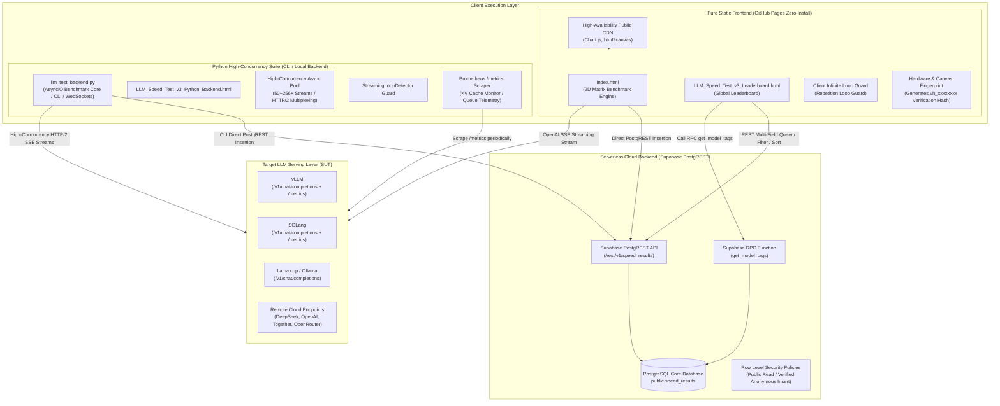

# 🚀 LLM Inference Speed Test & Leaderboard Platform v3.5

[](https://github.com/gengchaogit/llm_speedtest)
[](LICENSE)
[](https://gengchaogit.github.io/llm_speedtest/)
[](https://www.python.org/)
[](https://supabase.com)
[](https://github.com/gengchaogit/llm_speedtest/pulls)

---

🇬🇧 [**English Documentation (Current)**](#) | 🇨🇳 [**查看中文文档 (README.md)**](README.md)

---

✨ **Experience the zero-install pure frontend version online (No download / Zero setup / Instant benchmarking):**
- ⚡ **Matrix Benchmark Engine**: [**https://gengchaogit.github.io/llm_speedtest/**](https://gengchaogit.github.io/llm_speedtest/)
- 🏆 **Global Leaderboard**: [**https://gengchaogit.github.io/llm_speedtest/LLM_Speed_Test_v3_Leaderboard.html**](https://gengchaogit.github.io/llm_speedtest/LLM_Speed_Test_v3_Leaderboard.html)

---

## 1. Project Overview

**LLM Speed Test & Leaderboard Platform** is an enterprise-grade, open-source inference benchmarking suite and public performance leaderboard platform designed for the large language model ecosystem. Systematically absorbing the mathematical and engineering rigor of premier industry benchmarks (including `llm-inference-bench`, `vLLM benchmark_serving`, and `AIPerf`), the platform delivers authoritative measurements for **Time To First Token (TTFT)**, **Inter-Token Latency Jitter (ITL P50/P90/P99)**, **True Physical Wall-Clock Throughput (Wall-clock TPS)**, **Sustained Steady-State Decode**, **Effective Concurrency Ratio `(X/Y)*`**, and **Streaming Repetition Watchdog circuit breakers**.

The platform provides two complementary execution modes:
1. **Zero-Backend Pure Static Web Client**: Runs 100% inside standard web browsers without any custom server middleware. Visualizations are delivered via high-availability public CDNs, directly interacting with Supabase PostgreSQL through PostgREST protocol with zero operational overhead, hosted natively on GitHub Pages.
2. **High-Concurrency Python Suite**: Built upon AsyncIO with HTTP/2 multiplexed connection pools, bypassing the browser 6-connection limitation to support 50～256+ extreme concurrent streams. Includes Prometheus `/metrics` server telemetry and cross-platform one-click launchers.

---

## 2. System Architecture & Design Philosophy

### 2.1 High-Fidelity System Architecture Diagram (ASCII)

```text
+---------------------------------------------------------------------------------------------------+
|                                     CLIENT EXECUTION LAYER                                        |
|                                                                                                   |
|  [ Pure Static Web Client (GitHub Pages) ]          [ High-Concurrency Python Suite (CLI/Server) ]|
|  * index.html (2D Matrix Benchmark Engine)          * llm_test_backend.py (AsyncIO / CLI / WebAPI) |
|  * LLM_Speed_Test_v3_Leaderboard.html               * LLM_Speed_Test_v3_Python_Backend.html       |
|  * 100% CDN Delivery (Chart.js 4.4.1 / html2canvas) * 50~256+ HTTP/2 Pooled Concurrency (h2/httpx)  |
|  * Dual-Channel Repetition Watchdog Loop Guard      * Prometheus /metrics Scraper (KV Cache & Q)  |
|  * Client Canvas/Hardware Fingerprint (vh_xxxxxxxx) * True Wall-Clock Engine & (X/Y)* Saturation     |
+---------------------------------------------------------------------------------------------------+
             |                                                  |
             | (OpenAI SSE Stream / Ollama API)                 | (High-Concurrency HTTP/2 SSE Streams)
             v                                                  v
+---------------------------------------------------------------------------------------------------+
|                                      SERVING LAYER (SUT)                                          |
|                                                                                                   |
|  * vLLM  (/v1/chat/completions + /metrics)          * SGLang (/v1/chat/completions + /metrics)    |
|  * llama.cpp server (/v1/chat/completions)         * Ollama (/api/chat & /v1/chat/completions)    |
|  * Commercial APIs: OpenAI / DeepSeek / Together / OpenRouter / Compatible Endpoints             |
+---------------------------------------------------------------------------------------------------+
             |                                                  |
             | Direct Browser REST POST (Results & Fingerprint) | CLI Direct REST POST (Cloud Leaderboard)
             v                                                  v
+---------------------------------------------------------------------------------------------------+
|                              SERVERLESS CLOUD BACKEND (SUPABASE)                                  |
|                                                                                                   |
|  * PostgREST API: https://cvezaerrczywfzqcaqmx.supabase.co/rest/v1/speed_results                  |
|  * PostgreSQL Database (public.speed_results table with composite GIN & B-Tree indexes)           |
|  * RPC Stored Procedure: get_model_tags() aggregating verified model tags dynamically             |
|  * Row-Level Security (RLS): Public Select & Constrained Anonymous Insert without custom backend  |
+---------------------------------------------------------------------------------------------------+
```

### 2.2 Component Data Flow Diagram (Mermaid)



---

## 3. Feature Comparison Matrix

The table below contrasts this platform against major industry inference benchmarking solutions across 12 crucial technical dimensions:

| Evaluation Dimension (#) | This Platform (LLM Speed Test v3.5) | Ollama bench (Native) | vLLM benchmark_serving | llm-inference-bench (lil-bench) |
|---|---|---|---|---|
| **1. Architecture & Deployment** | **Dual Mode**: Zero-install GitHub Pages + Python CLI | CLI Command | Python CLI Script | Python CLI + Rich TUI |
| **2. Zero-Install Web Experience** | **✅ Supported**: Instant browser run, 0 dependencies | ❌ None | ❌ None | ❌ None |
| **3. Concurrency Capability** | **1 ～ 256+** (Web 1-6, Python 1-256+) | Single request (c=1) | High (rate-driven) | Matrix batch concurrency |
| **4. 2D Parameter Sweep Matrix** | **✅ Full Support** (Concurrency × Context grid) | ❌ Single point | ❌ Single batch | ✅ Concurrency × Context sweep |
| **5. Sustained vs. Burst Modes** | **✅ Full Support** (Sustained steady & Burst capacity) | ❌ Not supported | ❌ Queue burst only | ✅ Standard sustained & burst |
| **6. Sub-ms Latency Quantiles** | **✅ Full Quantiles** (TTFT and ITL P50/P90/P99) | Average & total only | Aggregate summary | ✅ P50/P90/P99 & StdDev Jitter |
| **7. True Wall-Clock Throughput** | **✅ Physical Span Union**, eliminates deceptive summation | Single stream only | Server aggregate TPS | ✅ Rigorous span union formula |
| **8. Repetition Watchdog Guard** | **✅ Dual-Channel**: Binary-search loop abort (Reasoning & Content channels) | ❌ None (runaway loops) | ❌ None | ✅ Sliding-window loop abort |
| **9. Server Queue Telemetry** | **✅ Supported**: Prometheus scraper & `(X/Y)*` ratio | ❌ None | ❌ No dynamic client link | ✅ Prometheus & effective concurrency |
| **10. Multi-Engine Compatibility** | **✅ Universal** (vLLM, SGLang, llama.cpp, Ollama, OpenAI) | Ollama only | Coupled with vLLM | vLLM, SGLang, Ollama |
| **11. Public Leaderboard & Sharing** | **✅ Global Leaderboard** (Pareto curve, Radar, Badges, Deep-links) | ❌ No leaderboard | ❌ No leaderboard | ❌ No cloud leaderboard |
| **12. Lossless Bilingual i18n** | **✅ 100% Offline Static** zh-CN & en-US hot switch | English only | English only | English only |

---

## 4. Benchmarking Methodology & Mathematical Rigor

Authoritative benchmark scores require uncompromising mathematical precision and physical reality. This platform computes all performance metrics according to the following formulas:

### 4.1 Time To First Token (TTFT)

**Definition**: The true physical elapsed duration between the exact microsecond the client dispatches the HTTP request payload and the arrival of the first non-empty streaming chunk (including reasoning/thinking markers).

For the $i$-th concurrent request ($`i \in [1, C]`$) in a test cell:

$$
\text{TTFT}_i = t_{\text{first}, i} - t_{\text{start}, i}, \quad i \in [1, C]
$$

The average TTFT across all streams in the test cell:

$$
\text{TTFT}_{\text{avg}} = \frac{1}{C} \sum_{i=1}^C \text{TTFT}_i
$$

Percentiles are calculated via **continuous linear interpolation**: for sorted observations $`Y = [y_1, y_2, \dots, y_N]`$, the $p$-th percentile rank is:

$$
k = (N - 1) \times \frac{p}{100}, \quad f = \lfloor k \rfloor, \quad \Delta = k - f
$$

$$
\text{Quantile}(Y, p) = y_f + \Delta \times (y_{f+1} - y_f)
$$

Yielding precise values for key latency percentiles (TTFT P50 / P90 / P99):

$$
\text{TTFT}_{P50}, \quad \text{TTFT}_{P90}, \quad \text{TTFT}_{P99}
$$

### 4.2 Inter-Token Latency (ITL) & Latency Jitter

**Definition**: The inter-arrival duration between successive emitted tokens during the autoregressive Decode phase: $`\Delta t_j = t_j - t_{j-1}`$. ITL jitter directly impacts streaming reading comfort and reflects serving memory scheduling turbulence.

Across a population of $M$ inter-token intervals in a benchmark cell, the mean and standard deviation are:

$$
\mu_{\text{ITL}} = \frac{1}{M}\sum_{j=1}^M \Delta t_j, \quad \sigma_{\text{ITL}} = \sqrt{\frac{1}{M}\sum_{j=1}^M (\Delta t_j - \mu_{\text{ITL}})^2}
$$

$$
\text{Jitter CV} = \frac{\sigma_{\text{ITL}}}{\mu_{\text{ITL}}} \times 100\%
$$

Together with the key inter-token latency percentiles (ITL P50 / P90 / P99):

$$
\text{ITL}_{P50}, \quad \text{ITL}_{P90}, \quad \text{ITL}_{P99}
$$

This rigorously captures garbage collection stutters, PagedAttention block swapping delays, or continuous batching re-scheduling hiccups.

### 4.3 True Wall-Clock Throughput (Eradicating Arithmetic Sums)

> ⚠️ **The Deceptive Summation Fallacy**: Under concurrent benchmarking, summing individual stream speeds ($`\sum \text{TPS}_i`$) is fundamentally erroneous whenever stream start/end times do not perfectly overlap. Naive arithmetic summation inflates reported throughput by 30% to 80%!

This platform computes system-level throughput strictly over the **physical wall-clock span union**:

$$
\Delta T_{\text{prefill, wall}} = \max_{i=1}^C(t_{\text{first}, i}) - \min_{i=1}^C(t_{\text{start}, i})
$$

$$
\Delta T_{\text{decode, wall}} = \max_{i=1}^C(t_{\text{end}, i}) - \min_{i=1}^C(t_{\text{first}, i})
$$

$$
\Delta T_{\text{e2e, wall}} = \max_{i=1}^C(t_{\text{end}, i}) - \min_{i=1}^C(t_{\text{start}, i})
$$

$$
\text{True Prefill Throughput (Tok/s)} = \frac{\sum_{i=1}^C N_{\text{prompt}, i}}{\Delta T_{\text{prefill, wall}}}
$$

$$
\text{True Decode Throughput (Tok/s)} = \frac{\sum_{i=1}^C N_{\text{output}, i}}{\Delta T_{\text{decode, wall}}}
$$

### 4.4 Sustained Decode vs. Burst Decode Benchmark Modes

- **Sustained Steady-State Decode**: Operates over an invariant physical duration window $`T_{\text{duration}}`$ (e.g., 30s or 60s) maintaining a steady concurrent worker pool. When any stream completes, a replacement request is dispatched immediately, measuring sustained saturation throughput under continuous backpressure.
- **Burst / E2E Decode**: Dispatches an instant batch of $`N = C \times K`$ requests simultaneously (e.g., a burst of 64 requests), measuring queue scheduling contention, P99 TTFT spikes, and cold-start tail latencies.

### 4.5 Effective Concurrency Ratio `(X/Y)*` & Server Queue Saturation

When serving execution slots are constrained (e.g., vLLM `--max-num-seqs` saturated or llama.cpp configured with `--parallel 1`), client concurrent requests are serialized inside the server queue.

Applying Little's Law to infer observed parallelism:

$$
P_{\text{inferred}} = \frac{\sum_{i=1}^C (t_{\text{end}, i} - t_{\text{start}, i})}{\Delta T_{\text{e2e, wall}}}
$$

- If $`P_{\text{inferred}} < 0.80 \times C`$ and $`C > 1`$: The server failed to execute streams concurrently. The benchmark cell and leaderboard record are tagged with the warning badge **`(X/Y)*`** (e.g., `(1/8)*` indicates 8 requests were dispatched, but the backend executed them serialized 1 at a time).

### 4.6 Repetition Watchdog Guard & Loop Abort

Deep reasoning models (e.g., DeepSeek-R1 series) and low-precision quantized models (e.g., INT4 / GGUF-Q2) are prone to entering runaway infinite generation loops upon encountering adversarial or edge prompts.

This platform implements a dual-channel real-time circuit breaker:
* **Periodic Suffix Detection (`exact_periodic_tail`)**: Reblocks incoming text in 256-character slices. Within the most recent 128 KiB history, it locates a 64-character suffix anchor and scans backward for candidate repeating periods $`P \in [1, 32768]`$. Binary search determines maximal contiguous repeating span $`L^*`$.
   - When cycle count $`C_{\text{cycles}} \ge 4`$ and span $`L^* \ge 4096`$ characters, a **`CONFIRMED_LOOP`** is triggered;
   - Action: Immediately fires `reader.cancel()` or `AbortController.abort()`, tags the cell with `ERROR: loop`, and assigns sentinel throughput `TPS = -3.0`, protecting GPU VRAM and preventing corrupted entries from contaminating the leaderboard;
   - **Dual-Channel Isolation**: Monitors reasoning traces (`reasoning_content` / `<think>`) and visible content channels independently to prevent cross-channel interference.

### 4.7 Pareto Frontier & Tamper-Evident Verification Hash (`vh_...`)

- **Throughput vs. Latency Pareto Frontier**: Balances competing performance objectives: maximize Throughput $T$ while minimizing Latency $L$. Point $p_a$ strictly dominates $p_b$ if $`T(a) \ge T(b) \land L(a) \le L(b) \land (T(a) > T(b) \lor L(a) < L(b))`$. Using $O(N \log N)$ sorting and monotonic scanning, non-dominated points are identified and rendered as an optimal stepped efficiency frontier curve.
- **Client Verification Hash (`vh_xxxxxxxx`)**: Combines client hardware concurrency, screen resolution, and canvas fingerprint $`F_{\text{env}}`$ with canonical benchmark parameters to compute a SHA-256 digest:

$$
H = \text{SHA-256}(P_{\text{payload}} \parallel F_{\text{env}})
$$

  yielding a tamper-evident badge `vh_xxxxxxxx` with `🛡️ Verified` status on the global leaderboard.

---

## 5. Quickstart Guide

### 5.1 Web Client Online (GitHub Pages, Zero-Install)

No Node.js, Python, or local server installation is needed:
1. Open [**https://gengchaogit.github.io/llm_speedtest/**](https://gengchaogit.github.io/llm_speedtest/) in any modern web browser;
2. Enter your serving endpoint URL (e.g., vLLM at `http://localhost:8000/v1` or Ollama at `http://localhost:11434/api/chat`);
3. Select benchmark mode (Single sweep, 2D Matrix sweep, or Sustained decode);
4. Click **"Start Benchmark"**. Once finished, upload results to the public leaderboard with one click to generate a canonical deep-link URL!

### 5.2 Python High-Concurrency CLI Suite

For high-concurrency stress testing (50+ streams) bypassing browser socket limits:

#### Step 1: Install Dependencies (Requires Python 3.10+)

```bash
cd python
pip install -r requirements.txt
```

#### Step 2: Run Benchmark via CLI (Supports 1D Sweep, 2D Matrix & Sustained Decode)

```bash
# Mode A: Standard 1D Concurrency Ladder Sweep (with Prometheus telemetry scraping)
python3 llm_test_backend.py --benchmark \
  --benchmark-mode 1d_sweep \
  --api-url http://localhost:8000/v1 \
  --model Qwen/Qwen2.5-7B-Instruct \
  --concurrency 1,4,16 \
  --contexts 512,1024,2048 \
  --max-tokens 128 \
  --metrics-url http://localhost:8000/metrics \
  --output benchmark_1d_report.json

# Mode B: 2D Concurrency × Context Matrix Sweep (with KV Cache budget skipping & scout traversal)
python3 llm_test_backend.py --benchmark \
  --benchmark-mode 2d_matrix \
  --api-url http://localhost:8000/v1 \
  --model Qwen/Qwen2.5-7B-Instruct \
  --matrix-concurrency 1,2,4,8 \
  --matrix-context 512,1024,2048 \
  --matrix-max-kv-tokens 32768 \
  --max-tokens 128 \
  --output benchmark_matrix_report.json

# Mode C: Sustained Steady-State Decode Benchmark (fixed 30s window, isolated TTFTs & steady TPS)
python3 llm_test_backend.py --benchmark \
  --benchmark-mode sustained_decode \
  --api-url http://localhost:8000/v1 \
  --model Qwen/Qwen2.5-7B-Instruct \
  --concurrency 4 \
  --sustained-duration 30.0 \
  --sustained-prompt-length 128 \
  --max-tokens 128 \
  --output benchmark_sustained_report.json
```

#### Step 3: Direct Upload to Global Leaderboard

```bash
python3 llm_test_backend.py --benchmark \
  --api-url http://localhost:8000/v1 \
  --model DeepSeek-R1-Distill-Qwen-14B \
  --concurrency 16 \
  --hardware "NVIDIA RTX 4090 24GB" \
  --framework "vLLM 0.6.3" \
  --quantization "AWQ-4bit" \
  --upload \
  --user-code "my_bench_9988" \
  --nickname "Hacker-Lab"
```

### 5.3 One-Click Cross-Platform Launchers

Convenient launcher scripts are located in `python/`:

- **macOS / Linux**:
  ```bash
  # Launch English UI
  bash python/run_for_linux_mac_en.sh
  # Launch Chinese UI
  bash python/run_for_linux_mac_zh.sh
  ```
- **Windows**:
  - Double-click `python/run_for_windows_en.bat` (English UI)
  - Double-click `python/run_for_windows_zh.bat` (Chinese UI, UTF-8 console encoding)
  - Double-click `python/run_for_windows_en_china_user.bat` (English UI + PyPI mirror acceleration)

---

## 6. CLI Reference & Configuration Options

Executing `python3 python/llm_test_backend.py` supports all standard options:

| Flag | Type | Default | Description |
|---|---|---|---|
| `--server`, `--serve` | Flag | `False` | Launch FastAPI & WebSocket local server mode |
| `--port PORT` | Int | `18000` | Port to bind server (auto-increments if occupied) |
| `--host HOST` | String | `0.0.0.0` | Host address to bind server |
| `--benchmark`, `--cli` | Flag | `False` | Launch headless CLI benchmarking mode |
| `--benchmark-mode`, `--mode` | Choice | `1d_sweep` | Benchmark execution mode: `1d_sweep`, `2d_matrix`, `sustained_decode` |
| `--task-type`, `--task` | Choice | `general` | Benchmark workload scenario library: `general` (General/Essay), `code` (Code Decode), `structured` (Structured JSON), `prose` (Prose & QA), `prefill_16k` (Technical Doc QA), `reasoning` (Math & Logic) |
| `--matrix-concurrency` | String | `'1,2,4,8'` | 2D matrix concurrency ladder, comma-separated |
| `--matrix-context` | String | `'512,1024,2048'` | 2D matrix context token length ladder, comma-separated |
| `--matrix-max-kv-tokens` | Int | `32768` | 2D matrix KV cache memory budget limit for cell skipping (0 for unlimited) |
| `--sustained-duration`, `--duration` | Float | `30.0` | Sustained decode target test duration in seconds |
| `--sustained-prompt-length` | Int | `128` | Sustained decode input prompt token length per request |
| `--api-url API_URL` | String | `http://localhost:8000/v1` | Target LLM inference serving endpoint root URL |
| `--api-key API_KEY` | String | `EMPTY` | API authentication bearer token |
| `--api-type {openai,ollama}` | Choice | `openai` | API communication protocol |
| `--model MODEL` | String | Required | Target model name or repository identifier |
| `--concurrency -c` | String | `1` | 1D mode concurrency level or comma-separated ladder (e.g. `1,4,16,64`) |
| `--contexts -l` | String | `100,500,2000` | 1D mode comma-separated prompt token length ladder |
| `--max-tokens -m` | Int | `128` | Maximum output tokens generated per request |
| `--temperature` | Float | `0.7` | Sampling temperature |
| `--top-p` | Float | `0.9` | Nucleus sampling top-p |
| `--metrics-url` | String | `None` | Serving engine Prometheus endpoint (e.g. `http://localhost:8000/metrics`) |
| `--hardware` | String | Auto | Hardware identifier (auto-detected via `nvidia-smi` / `sysctl` if omitted) |
| `--framework` | String | `vLLM` | Serving engine framework (vLLM, SGLang, Ollama, llama.cpp, etc.) |
| `--quantization` | String | `FP16` | Model quantization format (FP16, BF16, AWQ, GPTQ, GGUF, FP8, etc.) |
| `--upload` | Flag | `False` | Automatically upload benchmark results to public Supabase leaderboard |
| `--user-code` | String | `None` | User unique identifier (8-16 alphanumeric characters) |
| `--nickname` | String | `None` | Contributor or team nickname |
| `--notes` | String | `None` | Environment notes or driver versions |
| `--run-command` | String | `None` | Full command used to launch the inference server |
| `--output -o` | String | `None` | File path to export structured JSON benchmark report |
| `--no-watchdog` | Flag | `False` | Disable infinite loop watchdog circuit breaker |
| `--timeout` | Int | `120000` | Request timeout in milliseconds |

---

## 7. Global Leaderboard & Serverless Cloud Sync

The global leaderboard operates entirely serverless via Supabase PostgREST API, guaranteeing open accessibility and reliable data persistence:
- **Public Leaderboard URL**: [**LLM_Speed_Test_v3_Leaderboard.html**](https://gengchaogit.github.io/llm_speedtest/LLM_Speed_Test_v3_Leaderboard.html)
- **Multi-Dimensional Filtering**:
  - **Chip Architecture**: NVIDIA (Hopper / Ada / Ampere / Blackwell), Apple Silicon, AMD ROCm, CPU clusters;
  - **Quantization Precision**: FP16 / BF16, FP8, AWQ, GPTQ, GGUF (Q4/Q8), EXL2;
  - **Serving Framework**: vLLM, SGLang, llama.cpp, Ollama, TGI;
  - **Concurrency Levels**: 1, 2, 4, 8, 16, 32+ concurrency filter pills.
- **Advanced Visualizations**:
  - **Pareto Frontier Scatter**: Real-time throughput vs. TTFT optimal envelope;
  - **6D Capability Radar**: Prefill TPS, Decode TPS, TTFT responsiveness, ITL jitter stability, concurrency scalability, long-context retention;
  - **2D Matrix Perspective**: Interactive heatmap drill-down for Concurrency × Context performance degradation;
  - **Statistical Outlier Tagging**: Automated detection of anomalous or forged scores via IQR and domain sanity bounds.

---

## 8. Troubleshooting & FAQ

### Q1: Why is browser concurrency limited to 6?
**Answer**: Modern web browsers enforce a strict security limit of 6 simultaneous active TCP connections per domain under HTTP/1.1. To benchmark higher concurrency (8, 16, 32, 50+), use the included Python suite (`python/llm_test_backend.py`), which uses AsyncIO with connection pooling supporting 256+ concurrent streams.

### Q2: Why does `ERROR: loop` appear during testing?
**Answer**: This indicates that the **Repetition Watchdog** has triggered. Reasoning models (especially low-bit quantizations) can fall into infinite generation cycles. The watchdog trips when 4 identical cycles spanning $`\ge 4096`$ characters are detected, terminating runaway generation to protect GPU memory and prevent corrupted scores from polluting the leaderboard.

### Q3: Python CLI reports `ImportError: h2`？
**Answer**: The high-concurrency engine utilizes HTTP/2 multiplexing for efficient connection pooling. Install the complete requirements:
```bash
pip install -r python/requirements.txt
```

### Q4: Cannot connect to cloud leaderboard database?
**Answer**: The public leaderboard uses Supabase cloud endpoints (`cvezaerrczywfzqcaqmx.supabase.co`). When running offline or behind restricted corporate proxies, the platform automatically activates offline mode, caching benchmark data in browser `localStorage` or local JSON reports with full visualization support.

---

## 9. Contributing, Changelog & Credits

### 9.1 Changelog (v3.5.0 Release)
- 🚀 **Bilingual Documentation Overhaul**: 100% section parity between English and Chinese docs with academic-grade mathematical formulas and 12-factor comparison matrix;
- ⚡ **2D Matrix & Sustained Steady-State Decode Engines**: Full-stack support across static web client (`index.html`) and Python backend (`llm_test_backend.py`) for 2D Concurrency × Context matrix sweep and Sustained Steady-State decode benchmarking;
- 🛡️ **Dual-Channel Watchdog Guard & DOM Robustness**: Sliding-window binary search loop detector; completely eliminated DOM null exceptions on test cancellation with `AbortController` instant abort wiring;
- 📊 **Leaderboard Visualization Leap**: Pareto frontier curve, 6D capability radar chart, 2D matrix perspective heatmap, and verification badge states (`vh_xxxxxxxx`);
- 🐍 **High-Concurrency Telemetry Engine**: Python suite supporting 256 HTTP/2 concurrent connections, Prometheus `/metrics` scraping, and `(X/Y)*` queue saturation tagging;
- 🧪 **World-Class Industrial E2E Verification Suite**: 97 end-to-end automated tests with 431 assertions across 4 progressive tiers passing 100% with zero regressions;
- 🌐 **Zero Broken Link Guarantee**: Replaced fragile translation APIs with 100% offline static bilingual dictionary hot-toggle.

### 9.2 Credits
- Originally inspired by Bilibili creator **"Zhiyuan Suifeng"** and **DeepSeek-R1-0528** speed test scripts;
- 2D matrix benchmark methodologies and periodic loop detection inspired by [llm-inference-bench](https://github.com/local-inference-lab/llm-inference-bench);
- Special thanks to the teams behind vLLM, SGLang, Ollama, and llama.cpp for their outstanding contributions to open-source LLM inference.

### 9.3 Community & Feedback
- **GitHub Issues**: [Submit an issue or feature request](https://github.com/gengchaogit/llm_speedtest/issues)
- **Developer QQ Group**: 1028429001
- **GitHub Repository**: [https://github.com/gengchaogit/llm_speedtest](https://github.com/gengchaogit/llm_speedtest)
